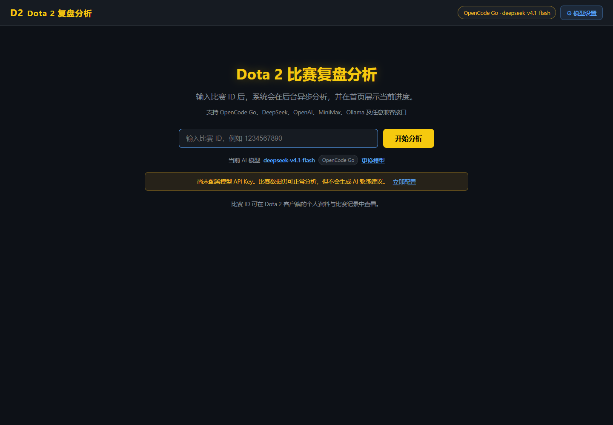
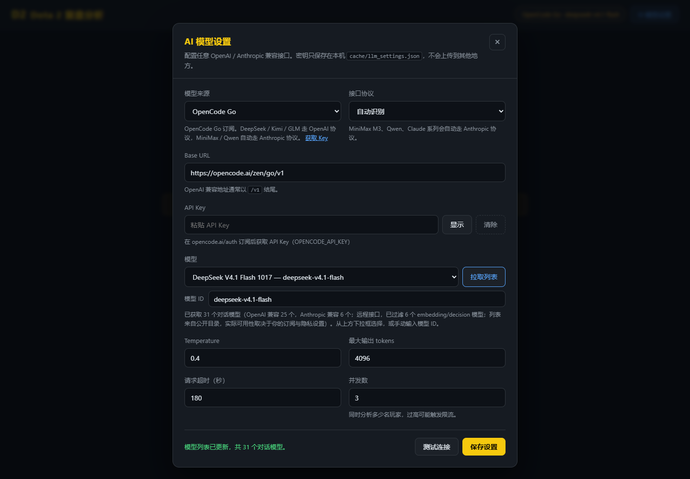
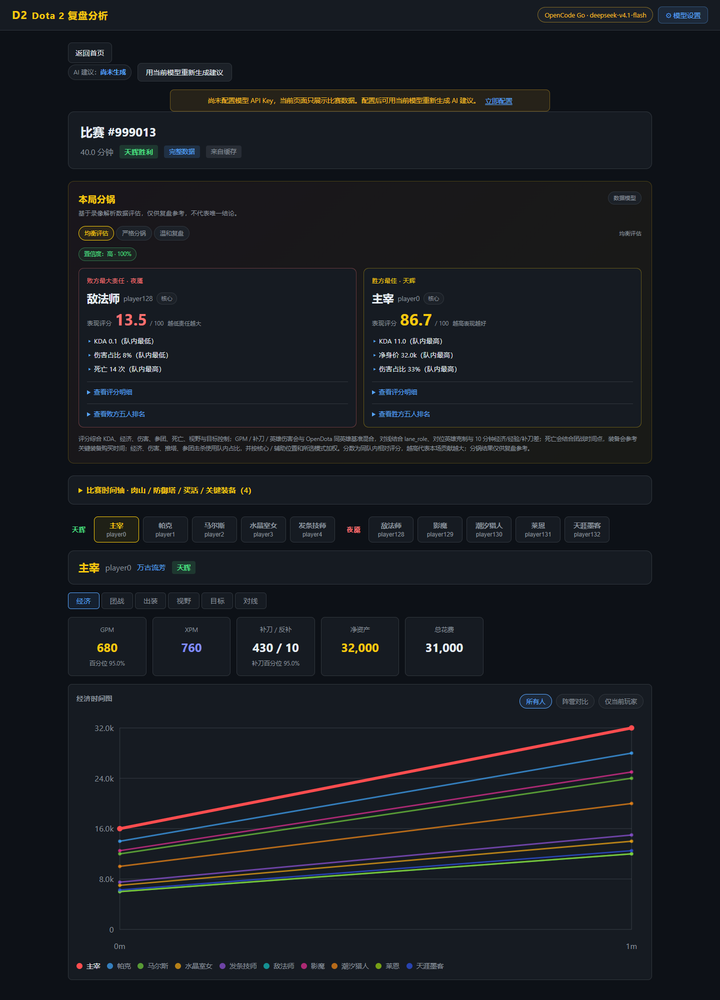
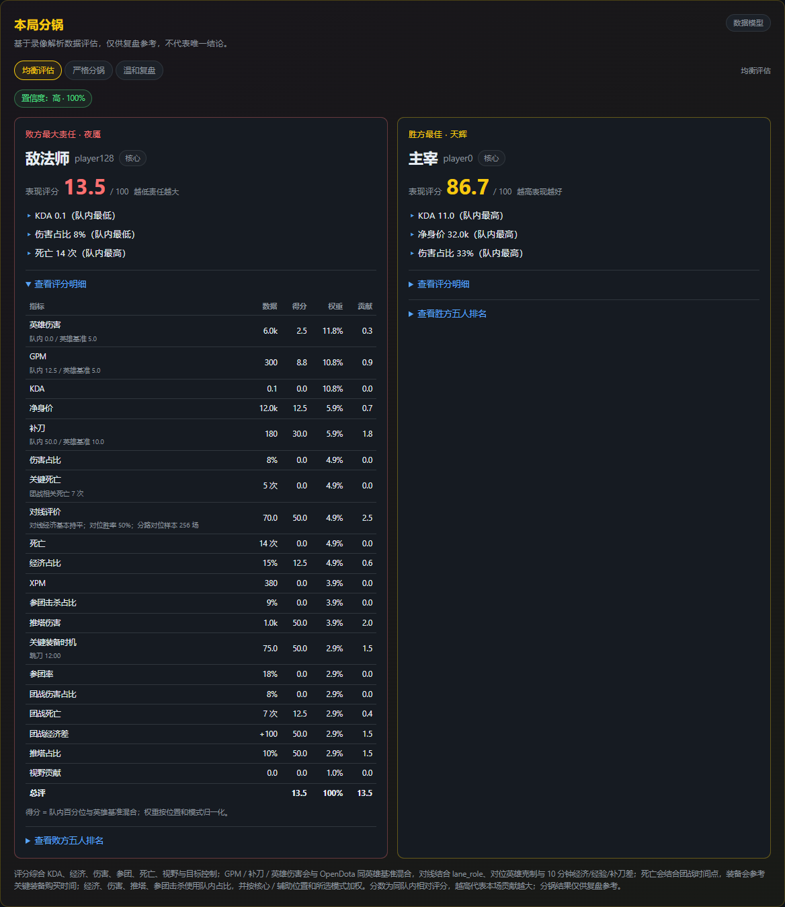
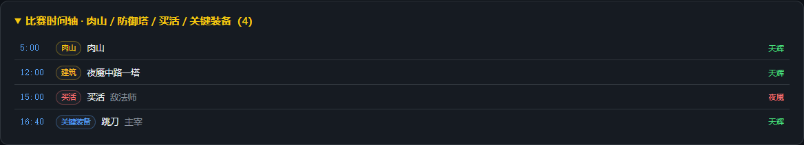
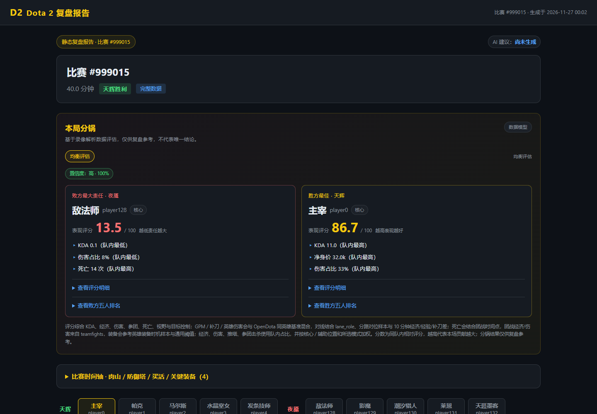
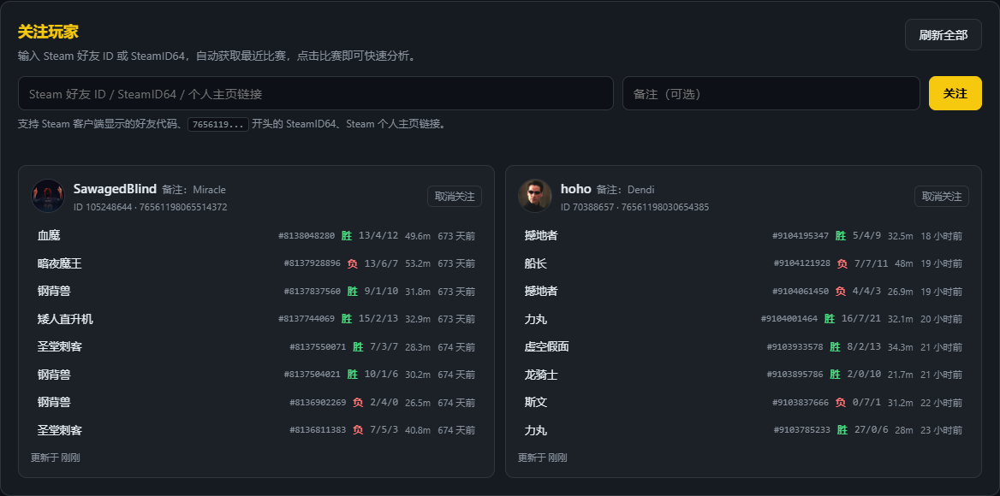

# Dota 2 比赛复盘助手（多模型版）

基于 FastAPI 的 Dota 2 比赛复盘 Web 应用。输入比赛 ID 后，从 OpenDota 拉取比赛数据，生成经济、团战、出装、视野、目标控制、对线等维度的结构化分析，并调用任意 OpenAI / Anthropic 兼容的大模型生成中文教练建议。

本项目 fork 自 [853qy/dota_analysis](https://github.com/853qy/dota_analysis)，在原版基础上做了以下改造：

- **不再绑定 MiniMax**：AI 来源、Base URL、API Key、模型均可配置
- **预设 OpenCode Go**：默认使用 `deepseek-v4.1-flash`
- **网页 GUI 配置**：右上角「模型设置」可填写 API Key、拉取模型列表、测试连接、保存配置
- **模型切换立即生效**：新分析直接使用当前模型；已有比赛可一键重新生成 AI 建议
- **协议自适应**：OpenAI 兼容（`/chat/completions`）与 Anthropic 兼容（`/messages`）双协议
- **配置持久化**：保存在本机 `cache/llm_settings.json`，不会提交到 Git

## 界面预览

### 首页



### 模型设置



### 比赛详情与分锅



### 评分明细



### 比赛时间轴



### 静态分享



### 关注玩家



## 功能特性

- 比赛 ID 输入，后台异步分析并实时展示进度
- **基础数据先展示**：录像未解析时先返回基础数据，不再阻塞等待
- **后台解析升级**：页面显示解析进度，OpenDota 解析完成后自动升级为完整数据
- 从 OpenDota 拉取比赛数据，自动检测录像解析状态
- 结构化分析：经济、团战、出装、视野、目标控制、对线
- 经济曲线可视化（所有人 / 阵营对比 / 当前玩家）
- AI 中文复盘建议，按玩家生成，包含模型标识与生成时间
- **解析后分锅分析**：败方最大责任、胜方最佳玩家、五人排名、英雄基准、队内占比、关键死亡与评分明细
- **对线评价**：lane_role、对线对手、10 分钟经济/经验/补刀差，以及英雄对位胜率修正
- **比赛时间轴**：肉山、防御塔、买活、关键装备时间点
- **分锅置信度**：高 / 中 / 低 / 证据不足，并列出缺失的数据来源
- **三种评分模式**：均衡评估 / 严格分锅 / 温和复盘，权重可自定义
- **Steam 好友关注**：输入好友代码 / SteamID64 / 个人主页，自动获取最近比赛 ID 并快速分析
- **静态 HTML 分享**：把比赛分析、分锅、时间轴和图表导出为可离线打开的单文件 HTML
- **本地永久存档**：分析结果、原始 OpenDota 数据和录像解析字段都保存在本地，后续可直接复查
- 多模型 GUI：来源预设、Base URL、API Key、模型列表、连接测试、超时与并发设置
- 已有比赛可用新模型重新生成 AI 建议，不影响已抓取的比赛数据

## 技术栈

- Python 3.10+
- FastAPI + Jinja2
- httpx（OpenDota、模型接口）
- Pydantic v2 + pydantic-settings
- 前端：原生 HTML / CSS / JS，无前端框架

## 快速开始

### 方式一：双击启动（推荐）

直接双击项目根目录的 `启动.bat`（或 `start.bat`）。

首次启动会自动完成：

1. 检查 Python 3.10+
2. 创建 `.venv` 虚拟环境
3. 安装 `requirements.txt` 中的依赖
4. 启动服务
5. 自动打开浏览器 `http://127.0.0.1:8000/`

之后再次双击会跳过安装，直接启动。服务运行在黑色命令行窗口中：

- **输入 `Q` 后按回车退出服务**
- 也可以按 `Ctrl+C`，或直接关闭命令行窗口
- 退出时浏览器页面会失效，这是正常现象

> 如果电脑没有 Python，请先从 [python.org](https://www.python.org/downloads/) 安装 Python 3.10+，安装时勾选 “Add python.exe to PATH”。

### 方式二：手动启动（开发用）

```bash
python -m venv .venv
# Windows
.venv\Scripts\activate
# macOS / Linux
source .venv/bin/activate

pip install -r requirements.txt
python main.py
```

打开 `http://127.0.0.1:8000/`。

> 默认只监听 `127.0.0.1`，因为配置文件里会保存 API Key。如果确实需要局域网访问，可在 `.env` 中设置 `APP_HOST=0.0.0.0`，并自行评估风险。启动器会读取 `.env` 中的 `APP_HOST` / `APP_PORT`。

### 3. 在网页里配置模型

1. 点击右上角「⚙ 模型设置」
2. 选择模型来源（默认 **OpenCode Go**）
3. 填写 API Key（OpenCode Go 的 Key 在 [opencode.ai/auth](https://opencode.ai/auth) 获取）
4. 点击「拉取列表」选择模型，默认 `deepseek-v4.1-flash`
   - 列表会显示所有可对话模型，并自动过滤 embedding / decision 等不能聊天的类型
   - 模型按 OpenAI / Anthropic 协议分组，选择后自动同步模型 ID 与协议
   - 也可以不拉取列表，直接在「模型 ID」输入框中手动填写
5. 点击「测试连接」确认可用，再点「保存设置」
6. 回到首页输入比赛 ID 开始分析

配置会写入 `cache/llm_settings.json`，下次启动自动读取。该文件已被 `.gitignore` 忽略，不会上传到 GitHub。

## 分析流程

1. 提交比赛 ID 后，后端先从 OpenDota 拉取比赛数据，并把原始 JSON 保存到本地
2. 如果录像已经解析：生成完整分析、AI 建议和分锅分析
3. 如果录像未解析：
   - **立即生成并展示基础数据**（比分、KDA、GPM/XPM、补刀、最终装备等）
   - 首页任务直接完成并跳转到详情页，不再阻塞等待录像解析
   - 后台继续向 OpenDota 提交解析请求并轮询状态
4. 详情页显示「基础数据」和解析进度；解析完成后自动刷新为「完整数据」，并生成 AI 建议与分锅分析
5. 之后再次打开同一比赛，直接读取本地存档，不重复下载

## 分锅分析

只有拿到录像解析数据后才会生成，展示在比赛详情页顶部：

- **败方最大责任**：败方五人中综合表现评分最低的玩家
- **胜方最佳玩家**：胜方五人中综合表现评分最高的玩家
- 两位玩家都会给出评分、位置（核心 / 辅助）和具体数据理由
- 可展开查看胜方 / 败方完整五人排名，以及每项指标的评分明细

### 评分现在包含什么

1. **同英雄基准**：GPM、补刀、英雄伤害会与 OpenDota 同英雄基准百分位各按 50% 混合，减少“不同英雄天生伤害/经济不同”的偏差。
2. **英雄定位**：优先使用 OpenDota 的英雄角色数据（Carry / Support 等），再结合经济与补刀判断核心 / 辅助；不是只看钱。
3. **队内占比**：经济占比、伤害占比、推塔占比、参团击杀占比。
4. **对线评价**：
   - 使用 `lane_role` + 物理分路匹配对线对手
   - 对比 10 分钟经济、经验、补刀差
   - 通过 OpenDota Explorer 聚合「英雄 A vs 英雄 B + 分路角色」的对位胜率
   - 分路对位样本不足时，回退到英雄总体对位胜率
   - 页面显示对线对手、10 分钟差、对位胜率和样本场次
5. **死亡时间**：除了死亡总数，还会统计「关键死亡」：
   - 团战开始前 10 秒内死亡
   - 团战开始后 10 秒内死亡
   这些死亡会视为更关键的减员，权重更高。
6. **团战结果**：使用 OpenDota `teamfights` 中每名玩家的：
   - 团战经济差
   - 团战伤害
   - 团战死亡
   作为独立的团战贡献指标；治疗量仍保留在常规维度中。
7. **装备与目标时间轴**：
   - 关键装备购买时间（跳刀、BKB、紫怨、笛子、大祭品等）
   - 装备时机优先使用 `scenarios/itemTimings` 的同英雄购买时间分布；样本不足时回退到通用阈值
   - 买活次数和买活时间点
   - 肉山、痛苦魔方、防御塔/兵营、一血、不朽盾
   - 统一展示在比赛详情页可展开的「比赛时间轴」
8. **常规维度**：KDA、XPM、净身价、参团率、视野贡献、治疗量、目标参与。
9. **位置权重**：核心更看经济/伤害/KDA，辅助更看参团/视野/治疗/目标。

评分是**同队内相对分数**，越高代表本场贡献越大。每个指标的得分、归一化权重和贡献会显示在「评分明细」表格里。

### 置信度与证据不足

分锅结果现在带置信度，显示在模式切换下方：

- **高**：关键数据覆盖充分
- **中**：缺少少量数据
- **低**：多项数据缺失
- **证据不足**：置信度低于 45%，页面会明确提示“证据不足”，并列出缺失的数据来源

置信度由这些数据的覆盖率计算：英雄定位、同英雄基准、对线数据、英雄对位胜率、死亡时间/团战窗口、团战经济/伤害、视野、参团率、关键装备时间、比赛时间轴。

> 置信度衡量的是**数据覆盖程度**，不是模型判断的准确率；高置信度只代表较少关键数据缺失。

常见缺失原因：

- 旧缓存没有新字段（重新解析后补齐）
- 录像解析不完整，没有 `lane` / `gold_t` / `lh_t` / `deaths_log`
- OpenDota 对位接口失败
- 玩家没有购买预设的关键装备
- 比赛没有可用时间轴事件

> 即使显示“证据不足”，页面仍会给出评分，但会明确标注可靠度，不会把缺失数据当成 0 分。

### 三种模式

比赛详情页顶部可以切换：

| 模式 | 特点 |
| --- | --- |
| 均衡评估 | 默认，经济/伤害/死亡/参团/视野平衡 |
| 严格分锅 | 提高死亡、关键死亡、经济与伤害差距的权重，责任判定更严厉 |
| 温和复盘 | 降低死亡惩罚，更强调参团、视野、治疗和目标贡献 |

默认模式可在 `.env` 设置：

```env
VERDICT_MODE=balanced
```

### 自定义权重

把 `docs/verdict_weights.example.json` 复制到 `cache/verdict_weights.json` 后修改。文件里填的是**倍率**，会乘到对应指标的基础权重上：

```json
{
  "strict": {
    "core": {
      "deaths": 2.0,
      "key_deaths": 2.2,
      "economy_share": 1.3
    },
    "support": {
      "vision": 0.7
    }
  }
}
```

- 也可以写成扁平形式，同时作用于核心和辅助
- `cache/verdict_weights.json` 已被 Git 忽略
- 指标 key 包括：`gpm`、`xpm`、`last_hits`、`net_worth`、`economy_share`、`hero_damage`、`damage_share`、`tower_damage`、`tower_share`、`kda`、`deaths`、`key_deaths`、`teamfight_deaths`、`teamfight_gold_delta`、`teamfight_damage_share`、`participation`、`kill_share`、`vision`、`healing`、`objectives`、`lane_evaluation`、`item_timing`

> 分锅结果是数据模型评估，不代表唯一结论。位置由英雄定位 + 经济/补刀推断；死亡时间基于 OpenDota 的 `deaths_log` 与团战窗口近似；对线依赖 10 分钟时间线、分路对位样本和英雄总体对位胜率，Explorer 聚合为全分段样本，样本不足会回退；装备时机优先使用 `scenarios/itemTimings` 的同英雄样本，样本不足回退通用阈值；团战贡献来自 `teamfights` 的经济/伤害/治疗数据。买活主要作为时间轴展示，不直接打分。没有纳入具体技能释放质量、对线消耗细节、队伍指挥和空间创造等无法量化的因素。

## 关注玩家

首页可以关注 Steam 好友，自动获取他们的最近 Dota 2 比赛 ID：

1. 在「关注玩家」输入框填写好友信息
2. 点击「关注」，程序会解析 Steam ID 并拉取最近 8 场比赛
3. 每场比赛显示英雄、胜负、KDA、时长、比赛 ID 和发生时间
4. 点击比赛即可直接进入分析：本地有存档就打开存档，没有就开始分析
5. 打开首页时会自动刷新超过 5 分钟的缓存；也可以点「刷新全部」

支持的输入格式：

| 格式 | 示例 |
| --- | --- |
| Steam 好友代码 / Dota 账号 ID | `123456789` |
| SteamID64 | `76561198000000001` |
| Steam 个人主页 | `https://steamcommunity.com/profiles/76561198000000001` |
| Steam 自定义主页 | `https://steamcommunity.com/id/yourname` |
| Steam2 / Steam3 | `STEAM_0:1:12345678`、`[U:1:123456789]` |

说明：

- Steam 客户端「好友」列表里显示的好友代码就是 Dota 2 账号 ID
- 自定义主页需要能公开访问；可在 `.env` 配置 `STEAM_API_KEY` 提高解析成功率
- 最多关注 20 人，每人显示最近 8 场，可在 `.env` 调整
- 关注列表、最近比赛和头像缓存保存在 `cache/follows.json`，已被 Git 忽略
- 如果对方隐藏了比赛记录，OpenDota 无法获取，会显示刷新失败原因
- OpenDota 偶尔会整体返回 500；应用会自动重试，失败时保留上次比赛数据，稍后点「刷新全部」即可
- 刚结束的比赛可能需要几分钟才会出现在 OpenDota 的最近比赛里

## 静态 HTML 分享

比赛详情页右上角有「导出静态 HTML」按钮，会把当前分析保存成一个单文件 HTML：

- CSS、应用脚本和图表脚本全部内联，不依赖本地服务
- 包含比赛头部、分锅、评分明细、时间轴、10 名玩家面板、AI 建议和经济图表
- 不需要登录，也不需要输入 API Key
- 不包含模型 API Key、设置和关注列表
- 如果当前是基础数据，也会导出，但会明确标记为基础数据
- 装备图标仍然引用 Steam CDN，完全离线打开时可能无法显示图标，但文字数据不受影响

导出文件默认名为：

```text
dota_match_<match_id>.html
```

接口：

```text
GET /match/{match_id}/export
```

> 导出的 HTML 会包含玩家昵称和比赛数据，分享前请确认对方是否可以查看这些信息。

## 支持的模型来源

| 来源 | Base URL | 默认模型 | 鉴权 |
| --- | --- | --- | --- |
| OpenCode Go | `https://opencode.ai/zen/go/v1` | `deepseek-v4.1-flash` | Bearer |
| DeepSeek 官方 | `https://api.deepseek.com/v1` | `deepseek-chat` | Bearer |
| MiniMax | `https://api.minimax.chat/v1` | `MiniMax-M2.7` | Bearer |
| OpenAI | `https://api.openai.com/v1` | `gpt-4.1-mini` | Bearer |
| Ollama / 本地 | `http://127.0.0.1:11434/v1` | 自定义 | 可留空 |
| 自定义 | 任意兼容地址 | 手动填写 | 可选 |

### 关于 OpenCode Go 的协议

OpenCode Go 同时提供两种协议：

- DeepSeek / Kimi / GLM / MiMo，以及 GPT / Gemini 等：使用 `/v1/chat/completions`（OpenCode 会把原生 Responses / Gemini 请求翻译成 Chat Completions）
- MiniMax M3、Qwen、Claude：使用 `/v1/messages`

程序默认使用「自动识别」：根据模型名前缀和 Base URL 选择协议。也可以在下拉框中强制指定协议。调用 OpenCode Go 时会自动附带它要求的 `x-opencode-session` 请求头。

> 对 OpenCode Go，「拉取列表」读取的是公开模型目录，因此会显示完整目录（当前 31 个对话模型）。你的订阅或工作区隐私设置可能只启用其中一部分，选完后点「测试连接」即可确认；如果返回 403，请到 OpenCode 控制台调整 Regions / Privacy 设置或升级套餐。

## 配置项

网页中可修改的配置：

| 配置 | 说明 | 默认 |
| --- | --- | --- |
| 模型来源 | 预设来源，切换时自动填充 Base URL 和模型 | OpenCode Go |
| 接口协议 | `auto` / `openai` / `anthropic` | `auto` |
| Base URL | 模型服务地址，通常以 `/v1` 结尾 | `https://opencode.ai/zen/go/v1` |
| API Key | 仅保存在本机；留空保存则不修改已有 Key | 空 |
| 模型 | 模型 ID，可从服务端拉取或手动输入 | `deepseek-v4.1-flash` |
| Temperature | 采样温度 | `0.4` |
| 最大输出 tokens | 单次请求上限 | `4096` |
| 请求超时 | 秒 | `180` |
| 并发数 | 同时分析多少名玩家 | `3` |

### 本地存档与解析参数

| 环境变量 | 说明 | 默认 |
| --- | --- | --- |
| `CACHE_TTL_SECONDS` | 分析结果保留时间；`0` 表示永久保留 | `0` |
| `CACHE_DIR` | 结构化分析存档目录 | `cache/matches` |
| `RAW_CACHE_DIR` | 原始 OpenDota 数据（含解析字段）存档目录 | `cache/raw` |
| `PARSE_POLL_INTERVAL` | 后台检查录像解析的间隔（秒） | `10` |
| `PARSE_MAX_ATTEMPTS` | 后台最多检查次数 | `30` |
| `VERDICT_MODE` | 默认分锅模式：`balanced` / `strict` / `gentle` | `balanced` |
| `VERDICT_WEIGHTS_FILE` | 自定义权重倍率文件 | `cache/verdict_weights.json` |
| `HERO_MATCHUP_CACHE_DIR` | 英雄对位胜率缓存目录 | `cache/hero_matchups` |
| `HERO_MATCHUP_CACHE_SECONDS` | 英雄对位缓存有效期（秒） | `604800` |
| `LANE_MATCHUP_CACHE_FILE` | 分路对位组合缓存 | `cache/lane_matchups.json` |
| `LANE_MATCHUP_CACHE_SECONDS` | 分路对位缓存有效期（秒） | `604800` |
| `LANE_MATCHUP_MIN_GAMES` | 使用分路对位数据的最少样本场次 | `10` |
| `ITEM_TIMING_CACHE_FILE` | 英雄装备时机分布缓存 | `cache/item_timings.json` |
| `ITEM_TIMING_CACHE_SECONDS` | 装备时机缓存有效期（秒） | `604800` |
| `ITEM_TIMING_MIN_GAMES` | 使用英雄装备时机基准的最少样本 | `8` |
| `FOLLOWS_FILE` | 关注列表与最近比赛存档 | `cache/follows.json` |
| `FOLLOWS_REFRESH_SECONDS` | 关注玩家最近比赛的自动刷新间隔（秒） | `300` |
| `FOLLOWS_MAX` | 最多关注人数 | `20` |
| `FOLLOWS_MATCH_LIMIT` | 每位玩家展示的最近比赛数 | `8` |
| `STEAM_API_KEY` | 可选，用于解析 Steam 自定义主页 | 空 |

> 默认会保留所有分析过的比赛，方便后续复查。只有把 `CACHE_TTL_SECONDS` 设为大于 0 时才会按时间过期。
>
> ⚠️ 删除 `cache/` 会同时删除本地比赛存档和已保存的 API Key（`cache/llm_settings.json`）。

### 环境变量（可选）

如果不想用网页保存配置，也可以在 `.env` 中提供首次启动的默认值，参考 `.env.example`：

```env
LLM_PROVIDER=opencode-go
LLM_BASE_URL=https://opencode.ai/zen/go/v1
LLM_MODEL=deepseek-v4.1-flash
LLM_API_KEY=sk-...
```

也兼容原有变量：

```env
MINIMAX_API_KEY=...
MINIMAX_BASE_URL=https://api.minimax.chat/v1
MINIMAX_MODEL=MiniMax-M2.7
```

> 网页保存过设置后，`cache/llm_settings.json` 优先于 `.env`。

## 本地配置与密钥安全

### 配置保存在哪里

| 内容 | 路径 | 是否提交 Git |
| --- | --- | --- |
| 模型来源、Base URL、API Key、模型、参数 | `cache/llm_settings.json` | 否 |
| 可选的环境变量默认值 | `.env` | 否 |
| 结构化分析存档 | `cache/matches/*.json` | 否 |
| 原始 OpenDota 数据（含录像解析字段） | `cache/raw/*.json` | 否 |
| 关注玩家与最近比赛缓存 | `cache/follows.json` | 否 |
| 英雄对位胜率缓存 | `cache/hero_matchups/*.json` | 否 |
| 分路对位组合缓存 | `cache/lane_matchups.json` | 否 |
| 英雄装备时机分布缓存 | `cache/item_timings.json` | 否 |
| 环境变量模板 | `.env.example` | 是（仅占位符） |

API Key 只会写入本机 `cache/llm_settings.json`。`.gitignore` 已显式忽略：

```gitignore
.env
.env.*
!.env.example
cache/
llm_settings.json
**/llm_settings.json
.claude/settings.local.json
```

### 上传 GitHub 前自查

```bash
git status --short
git check-ignore -v cache/llm_settings.json .env
git ls-files | grep -E "(^|/)\.env$|llm_settings\.json|^cache/"
```

Windows PowerShell 版本：

```powershell
git status --short
git check-ignore -v cache/llm_settings.json .env
git ls-files | Select-String -Pattern "llm_settings.json|^cache/|(^|/)\.env$"
```

预期结果：

- `git status` 不出现 `cache/`、`.env`、`llm_settings.json`
- `git check-ignore` 能输出对应的忽略规则
- `git ls-files` 只可能列出 `.env.example`，不会列出真实配置文件

> 如果不小心提交过 Key：先去模型平台撤销并重新生成 Key，再用 `git filter-repo` 或 BFG 清理历史。只删除当前文件不够，旧提交里仍然能读到 Key。

### 其他安全建议

- API Key 在本地配置文件中是明文，请注意电脑和账户安全。
- 服务默认只监听 `127.0.0.1`，不要在没有额外鉴权的情况下暴露到公网。
- `/api/llm/models` 只会在请求的 Base URL 与已保存地址同源时复用已保存的 Key，避免把 Key 发送到任意第三方域名。
- 网页只会收到打码后的 Key（如 `sk-a…cdef`），不会回显完整 Key。

## 使用说明

1. 首页输入比赛 ID（可从 Dota 2 客户端或第三方战绩站获取）
2. 后台拉取 OpenDota 数据；若录像尚未解析，先展示基础数据，并自动轮询检查
3. 分析完成后跳转详情页，按玩家查看经济、团战、出装、视野、目标、对线
4. 详情页右上角可看到生成 AI 建议所用的模型，并可「用当前模型重新生成建议」
5. 切换模型后，新旧比赛都可重新生成建议，不必重新抓取 OpenDota 数据

## API

| 方法 | 路径 | 说明 |
| --- | --- | --- |
| GET | `/api/llm/settings` | 读取当前模型配置（Key 已打码） |
| PUT | `/api/llm/settings` | 保存模型配置 |
| POST | `/api/llm/settings/clear-key` | 清除已保存的 API Key |
| GET | `/api/llm/models` | 拉取模型列表，失败时回退预设列表 |
| POST | `/api/llm/test` | 用当前表单参数做一次真实对话测试 |
| POST | `/analyze` | 提交比赛分析任务 |
| GET | `/api/jobs/{match_id}` | 查询比赛分析进度 |
| GET | `/api/match/{match_id}/data` | 获取结构化分析 JSON（含分锅结果） |
| GET | `/match/{match_id}/export` | 导出可离线打开的单文件静态 HTML |
| GET | `/api/match/{match_id}/parse` | 查询后台录像解析状态 |
| POST | `/api/match/{match_id}/parse` | 重新提交录像解析检查 |
| POST | `/api/match/{match_id}/reanalyze` | 用当前模型重新生成 AI 建议 |
| GET | `/api/follows` | 获取关注列表与最近比赛缓存 |
| POST | `/api/follows` | 关注玩家（Steam 好友 ID / SteamID64 / 主页） |
| DELETE | `/api/follows/{account_id}` | 取消关注 |
| POST | `/api/follows/refresh` | 刷新关注玩家的最近比赛 |
| GET | `/api/match/{match_id}/reanalyze` | 查询重新生成任务状态 |

## 项目结构

```
├── start.bat                     # 一键启动（英文文件名）
├── 启动.bat                      # 一键启动（中文文件名）
├── scripts/launcher.py           # 启动器：等待服务、打开浏览器、Q 退出
├── main.py                       # FastAPI 入口
├── requirements.txt
├── requirements-dev.txt
├── .env.example                  # 仅占位符，可安全提交
├── .gitignore                    # 忽略 .env / cache / 本地模型配置
├── .gitattributes
│
├── app/
│   ├── config.py                 # 环境变量与默认配置
│   ├── routers/
│   │   ├── analysis.py           # 比赛分析、进度、重新生成建议
│   │   ├── follows.py            # 关注玩家、最近比赛
│   │   └── llm.py                # 模型设置、模型列表、连接测试
│   ├── models/
│   │   ├── match.py              # OpenDota 原始数据模型
│   │   └── analysis.py           # 结构化分析结果模型
│   ├── services/
│   │   ├── opendota.py           # OpenDota 客户端
│   │   ├── data_processor.py     # 数据清洗与结构化
│   │   ├── verdict.py            # 分锅评分：败方责任 / 胜方最佳
│   │   ├── hero_matchups.py      # 英雄对位胜率缓存
│   │   ├── lane_matchups.py      # 分路对位组合（Explorer 聚合）
│   │   ├── item_timings.py       # 英雄装备时机分布
│   │   ├── follows.py            # Steam ID 解析、关注列表与最近比赛
│   │   ├── ai_analyzer.py        # 提示词、JSON 解析、AI 建议
│   │   ├── llm_client.py         # OpenAI / Anthropic 双协议传输
│   │   ├── llm_settings.py       # 模型配置持久化与预设
│   │   ├── cache.py              # 本地存档（分析 + 原始数据）
│   │   └── analysis_jobs.py      # 进程内任务管理
│   └── utils/                    # 英雄 / 道具中文名、限速
│
├── templates/                    # 页面与模型设置弹窗
│   ├── share.html                # 单文件静态分享模板
│   └── partials/match_report.html # 比赛页与分享页共用内容
├── static/js/settings.js         # 模型设置 GUI
├── static/js/follows.js          # 关注玩家 GUI
├── tests/                        # 解析、分锅、关注与配置单元测试
├── docs/screenshots/             # README 截图
└── docs/verdict_weights.example.json  # 自定义分锅权重示例
```

## 测试

```bash
pip install -r requirements-dev.txt
pytest -q
```

## 数据流

1. 用户在首页提交比赛 ID
2. 后端从 OpenDota 获取比赛数据，并把原始 JSON 保存到 `cache/raw/`
3. 判断录像是否已解析
4. **未解析**：
   - `DataProcessor` 生成基础分析并立即写入 `cache/matches/`
   - 首页任务完成并跳转详情页
   - 后台任务继续轮询 OpenDota，解析完成后生成完整分析、分锅结果和 AI 建议
5. **已解析**：
   - 生成完整分析、分锅结果，并调用 AI 生成建议
   - 写入 `cache/matches/`
6. 详情页轮询 `/api/match/{id}/parse`，解析升级完成后自动刷新
7. 之后再次打开同一比赛，直接读取本地存档

如果 AI 调用失败：

- 比赛数据仍会保存，详情页会显示具体错误
- 已存在建议的比赛重新生成失败时，会保留原有建议
- 常见错误（401 / 403 / 404 / 429 / 超时）会在 UI 中给出中文提示

如果录像解析失败：

- 基础数据会完整保留
- 页面显示「基础数据」，可点击「重新检查解析」重试
- 后台默认等待约 5 分钟（`PARSE_MAX_ATTEMPTS × PARSE_POLL_INTERVAL`）

## 从原项目升级

- 依赖已升级到 Pydantic v2 / 新版 FastAPI，请重新安装 `requirements.txt`
- 缓存版本仍为 `4`；新增的分锅字段是可选字段，旧缓存可以继续读取，打开详情页时会自动补算分锅结果
- 默认不再按 24 小时过期，已分析比赛会永久保留；如需自动过期请设置 `CACHE_TTL_SECONDS`
- 原有 `MINIMAX_API_KEY` 配置仍兼容；未显式设置 `LLM_PROVIDER` 时会自动沿用 MiniMax
- 原 `claude_analyzer.py` 已替换为 `ai_analyzer.py`，逻辑不再绑定具体厂商

## 发布到自己的 GitHub

当前目录保留着原仓库的 Git 历史，并已创建分支 `feature/multi-provider-gui`。

### 1. 在 GitHub 创建空仓库

- 仓库名建议：`dota-analysis` 或 `dota2-review-assistant`
- **不要**勾选自动生成 README / .gitignore / LICENSE
- 简介建议：`Dota 2 match review assistant with OpenDota data and a multi-provider LLM GUI.`
- Topics 建议：`dota2`, `fastapi`, `opendata`, `llm`, `opencode`, `ai-coach`

### 2. 推送前检查

```bash
git status --short
git check-ignore -v cache/llm_settings.json .env
git ls-files | grep -E "(^|/)\.env$|llm_settings\.json|^cache/"
pytest -q
```

确认没有密钥和本地缓存后，再执行推送。

### 3. 添加远程并推送

```bash
git remote add origin https://github.com/<你的用户名>/<仓库名>.git
git push -u origin feature/multi-provider-gui
```

如果希望 `main` 作为默认分支：

```bash
git checkout -b main
git push -u origin main
```

### 4. 仓库设置建议

- 不要用「上传文件夹」的方式打包整个目录，避免把 `.venv/`、`cache/`、`.env` 一起传上去
- 使用 `git push` 推送，`.gitignore` 会自动排除本地文件
- 建议在仓库 About 中填写简介和 Topics
- 如果原项目没有 LICENSE 文件，公开发布前请确认原作者授权

### 5. 发布前检查清单

- [ ] `git status` 中没有 `cache/`、`.env`、`llm_settings.json`
- [ ] `git ls-files` 中没有真实 API Key
- [ ] `.env.example` 中只有占位符
- [ ] `pytest -q` 全部通过
- [ ] 双击 `启动.bat` 能正常启动
- [ ] 首次打开页面能配置模型并完成一次比赛分析
- [ ] README 中的仓库地址、分支名和截图与实际一致

## 注意事项

- 分析结果保存在 `cache/matches/`，原始 OpenDota 数据（含解析字段）保存在 `cache/raw/`
- 默认永久保留，方便后续复查；设置 `CACHE_TTL_SECONDS>0` 才会自动过期
- 删除 `cache/` 会同时删除已保存的 API Key 配置
- OpenDota 对未解析录像需要等待，页面会先展示基础数据并在后台自动升级
- 分锅分析依赖录像解析数据，基础数据阶段不会生成
- 分锅评分会在打开详情页时按当前模式和自定义权重重新计算；旧缓存会自动补齐评分明细
- 分锅置信度低于 45% 时会标记为“证据不足”，并列出缺失的数据来源
- 英雄对位胜率缓存在 `cache/hero_matchups/`，默认 7 天；删除不影响分析，只会重新拉取
- 关注列表与最近比赛缓存在 `cache/follows.json`，默认 5 分钟自动刷新
- Steam 隐私设置会限制 OpenDota 能获取到的最近比赛
- 进程内任务管理适合单机使用；多实例部署需要换成 Redis / 队列
- 模型返回非 JSON 内容时，会降级为原始文本展示并在页面提示

## 项目来源与授权

本项目基于 [853qy/dota_analysis](https://github.com/853qy/dota_analysis) 修改，保留了原仓库的 Git 历史与致谢。原仓库未附带单独的 LICENSE 文件；如果要公开分发或商用，请先确认原作者的授权，并保留本节的来源说明。
